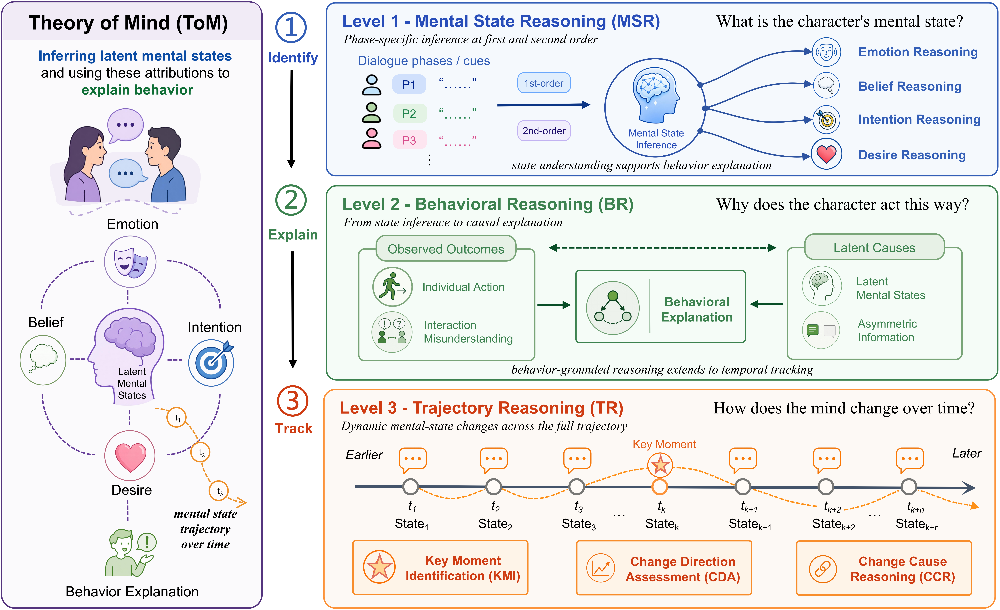
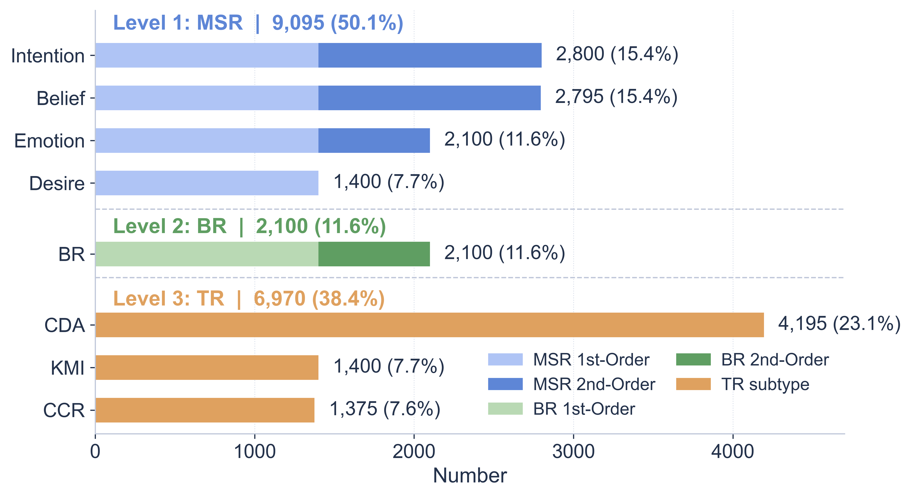

<div align="center">

# TrajToM

### Evaluating Theory of Mind over Mental-State Trajectories in Social Dialogues

<p>
  <a href="#overview">Overview</a> &bull;
  <a href="#task-taxonomy">Task Taxonomy</a> &bull;
  <a href="#dataset-statistics">Statistics</a> &bull;
  <a href="#quick-start">Quick Start</a> &bull;
  <a href="#data">Data</a> &bull;
  <a href="#training">Training</a> &bull;
  <a href="#evaluation">Evaluation</a> &bull;
  <a href="#license">License</a>
</p>

[](https://www.python.org/)
[](#license)
[](#license)

</div>

## Overview

Theory of Mind (ToM) is essential for understanding social dialogue: characters' mental states are rarely stated explicitly, evolve through interaction, and shape subsequent behavior. Existing ToM benchmarks mainly focus on selected dialogue turns or state changes across separate scenarios, leaving within-dialogue mental-state trajectories underexplored.

**TrajToM** is a benchmark for evaluating whether large language models can reason over evolving emotions, beliefs, intentions, and desires in continuous social dialogue. Built with a **Sketch-first** construction paradigm, it covers mental state reasoning, behavioral reasoning, and trajectory reasoning. This repository provides the benchmark data, evaluation scripts, and training utilities used in the study.

<table>
  <tr>
    <td align="center"><b>Mental-state reasoning</b><br>Track beliefs, intentions, emotions, and desires.</td>
    <td align="center"><b>Behavior explanation</b><br>Connect observable actions to their underlying causes.</td>
    <td align="center"><b>Trajectory reasoning</b><br>Identify turning points, directions, and causes of change.</td>
  </tr>
</table>

## Task Taxonomy

<p align="center">
  
</p>

TrajToM organizes Theory of Mind evaluation into a three-level hierarchy that moves from phase-specific state inference, to behavior explanation, to reasoning about mental-state changes over an entire dialogue. This progression avoids treating mental-state change as an isolated capability: a model must infer states within a phase, link them to observable behavior, and integrate evidence distributed across the trajectory to determine when, how, and why a state changes.

| Level | Task | What the model must reason about |
| --- | --- | --- |
| **Level 1** | **Mental State Reasoning (MSR)** | Infer emotion, belief, intention, and desire at a specific dialogue phase, at both first and second order. |
| **Level 2** | **Behavioral Reasoning (BR)** | Explain actions and misunderstandings from latent mental states and asymmetric information. |
| **Level 3** | **Trajectory Reasoning (TR)** | Track dynamic changes through **key moment identification (KMI)**, **change direction assessment (CDA)**, and **change cause reasoning (CCR)**. |

KMI identifies the turning point at which a substantial shift occurs; CDA characterizes how a mental dimension changes across phases; and CCR identifies the statement or event responsible for the shift.

## Repository Layout

```text
TrajToM/
├── data/                         # Released benchmark and split metadata
│   ├── tom_profiles*.json         # Character profiles
│   ├── tom_sketches*.json         # Scenario-level mental-state annotations
│   ├── tom_dialogues*.json        # Social dialogues
│   ├── tom_questions*.json        # Multiple-choice ToM questions
│   ├── data_split.json            # Training/development dialogue splits
│   └── sketch_schema.json         # Annotation schema
├── evaluate/
│   ├── evaluate_tom.py            # Evaluation for local and API models
│   └── requirements.txt
├── training/
│   ├── sft_data_generation.py     # Build structured SFT rationales
│   ├── build_alignment_targets.py # Construct GRPO alignment targets
│   ├── precompute_embeddings.py   # Encode alignment targets
│   ├── build_grpo_dataset.py      # Assemble the GRPO dataset
│   ├── train_grpo.py              # GRPO training entry point
│   ├── merge_grpo_surgery.py      # Merge trained adapters
│   ├── eval.sh                    # Merge-and-evaluate example
│   └── requirements.txt
└── README.md
```

Files with the `*_test.json` suffix form the held-out evaluation split. Please do not use them for training or prompt tuning.

## Quick Start

Clone the repository and install the dependencies needed for the workflow you intend to run.

```bash
git clone https://github.com/Louis1316/TrajToM.git
cd TrajToM

# Evaluation
pip install -r evaluate/requirements.txt

# Optional: training utilities
pip install -r training/requirements.txt
```

## Data

Each item in `data/tom_questions.json` is a four-option multiple-choice question grounded in one dialogue. It includes the question type, target character, answer key, and an explanation. The associated dialogue, profile, and sketch files are linked through `dialogue_id` and `sketch_id`.

Use `data/tom_questions_test.json` together with `data/tom_dialogues_test.json` for standard benchmark evaluation. The released `data/data_split.json` defines the training and development partitions used by the training utilities.

## Dataset Statistics

<p align="center">
  
</p>

TrajToM contains **700 dialogues** and **18,165 four-option multiple-choice questions**, with an average of **18.0 turns** and **25.9 questions** per dialogue. It covers eight subtypes: four MSR dimensions, one BR category, and three TR subtypes.

| Level | Questions | Share | Coverage |
| --- | ---: | ---: | --- |
| **MSR** | 9,095 | 50.1% | Emotion, belief, intention, and desire |
| **BR** | 2,100 | 11.6% | Three balanced behavior-explanation patterns |
| **TR** | 6,970 | 38.4% | KMI, CDA, and CCR |
| **Total** | **18,165** | **100.0%** | **Eight task subtypes** |

Among order-sensitive MSR and BR questions, **7,000** are first-order and **4,195** are second-order.

## Evaluation

Evaluate a local vLLM-served model on the held-out test set:

```bash
python evaluate/evaluate_tom.py \
  --model-type vllm \
  --model-path /path/to/model \
  --data-path data/tom_questions_test.json \
  --dialogue-path data/tom_dialogues_test.json \
  --output-dir results/
```

`evaluate_tom.py` also supports OpenAI-compatible endpoints via `--model-type api`. Run the following command to see all supported options:

```bash
python evaluate/evaluate_tom.py --help
```

## Training

The training utilities support a two-stage recipe:

1. **SFT**: convert the released question explanations into structured reasoning traces, then fine-tune with your preferred SFT framework (for example, [LLaMA-Factory](https://github.com/hiyouga/LLaMA-Factory)).
2. **GRPO**: build sketch-grounded alignment targets and train with `training/train_grpo.py`.

Prepare GRPO inputs from the released training split:

```bash
mkdir -p training/artifacts

python training/build_alignment_targets.py \
  --data_dir data \
  --split train \
  --output training/artifacts/alignment_targets_train.jsonl

python training/precompute_embeddings.py \
  --input training/artifacts/alignment_targets_train.jsonl \
  --output_npy training/artifacts/alignment_embeddings_train.npy \
  --output_ids training/artifacts/alignment_embeddings_train.ids.json

python training/build_grpo_dataset.py \
  --data_dir data \
  --split train \
  --output training/artifacts/grpo_train.jsonl
```

Pass the generated dataset and embedding paths to `training/train_grpo.py`. See `python training/train_grpo.py --help` for its configurable training arguments. The merge-and-evaluate example in `training/eval.sh` requires local model and environment paths to be configured first.

To generate structured SFT rationales through an OpenAI-compatible API, set `OPENAI_API_KEY` and run:

```bash
python training/sft_data_generation.py \
  --output training/artifacts/sft_train_data.json
```

Use `--model` and `--base_url` when using a different compatible endpoint.

## License

**Dataset.** TrajToM is released under [CC BY-NC 4.0](https://creativecommons.org/licenses/by-nc/4.0/), for research and evaluation use. It must not be used for psychological profiling, manipulation, surveillance, unwanted persuasion, high-stakes decision-making, or to infer or influence private mental states without consent.

**Code.** The code in this repository is released under the MIT License.
